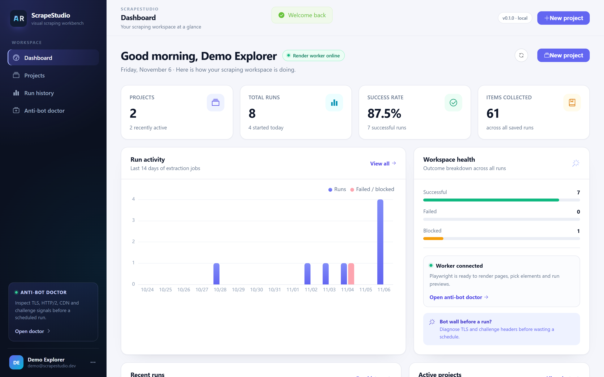
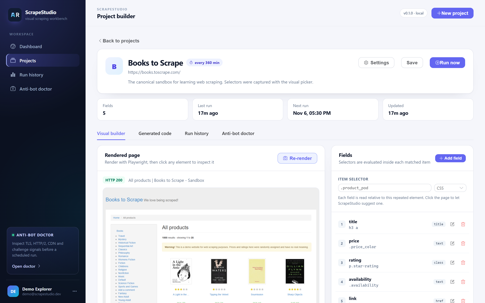
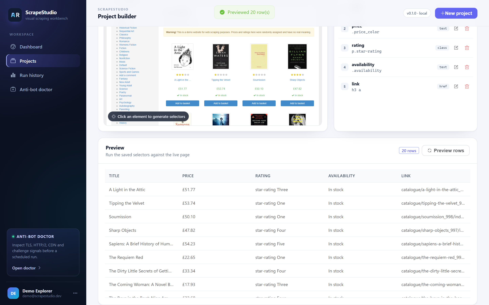
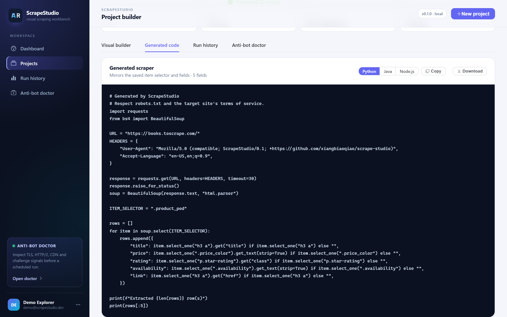
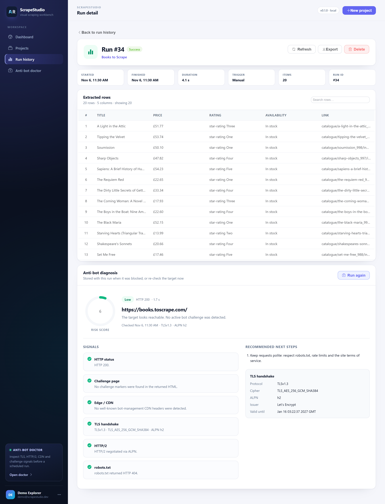
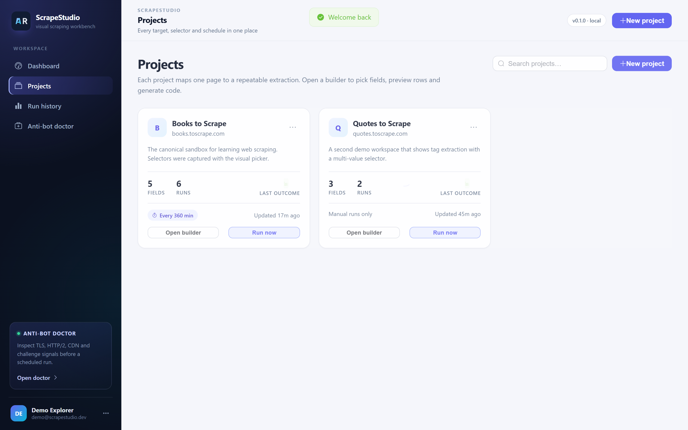
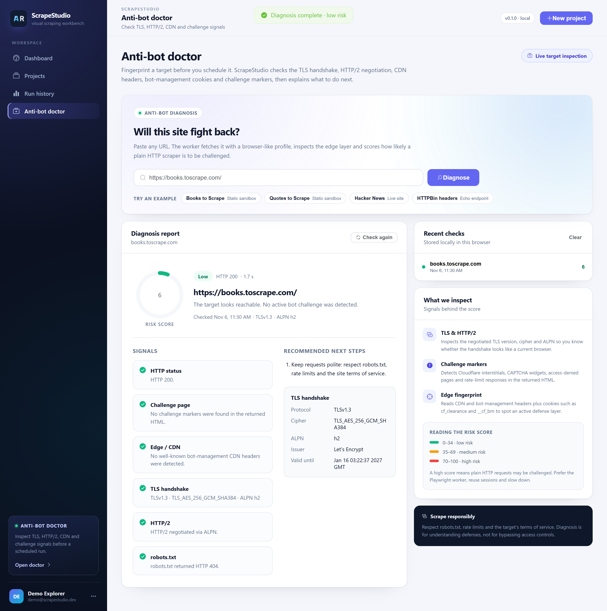
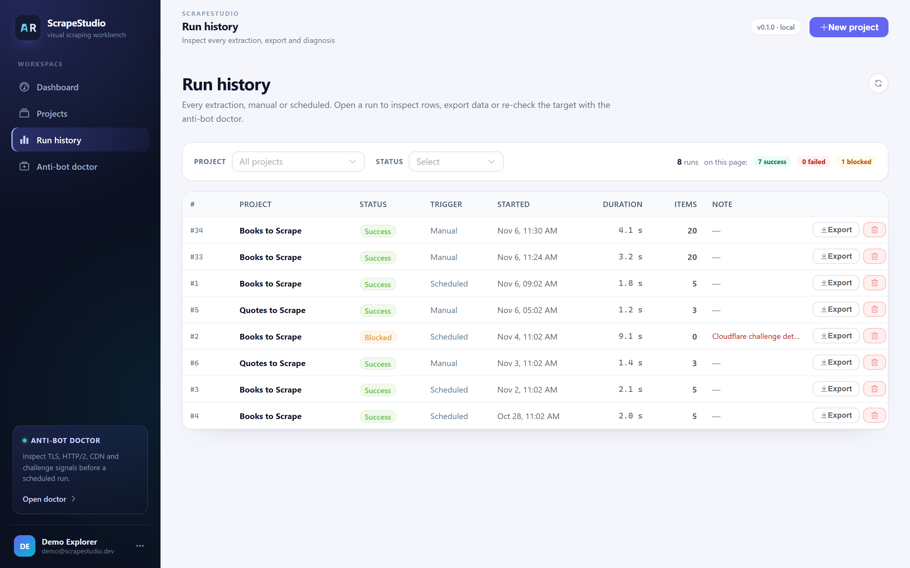
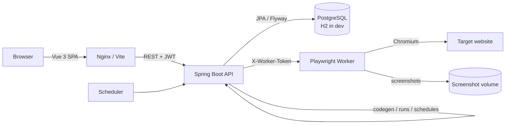

<div align="center">

# ScrapeStudio

**A visual web scraping workbench with a built-in anti-bot doctor.**

Click a page, define fields, preview real data, generate production code, schedule runs, and find out why a site fights back — all in one self-hosted app.

[](https://github.com/xiangbiaoqiao/scrape-studio/actions/workflows/ci.yml)
[](https://adoptium.net/)
[](https://spring.io/projects/spring-boot)
[](https://vuejs.org/)
[](https://www.typescriptlang.org/)
[](https://playwright.dev/)
[](LICENSE)

[Features](#-features) · [Quick start](#-quick-start) · [Screenshots](#-screenshots) · [Architecture](#-architecture) · [Docs](#-documentation)

</div>



## Why ScrapeStudio?

Most scraping tools stop after extracting a few selectors. Real scraping work starts when the site changes its markup, rate-limits you, serves a challenge page, or silently returns zero rows at 2 a.m.

ScrapeStudio treats scraping as a full workflow:

- **Build visually** — click elements on a rendered screenshot instead of guessing CSS.
- **Validate immediately** — preview rows against the live page before saving anything.
- **Ship anywhere** — export the same scrape as Python, Java, or Node.js code.
- **Operate it** — schedule runs, inspect history, export CSV/JSON, and read failure reasons.
- **Diagnose blockers** — the anti-bot doctor inspects TLS, HTTP/2, CDN headers, cookies, robots.txt, and challenge markers, then explains the risk in plain language.

It is fully self-hosted, MIT licensed, and built on a deliberately boring stack: Spring Boot, PostgreSQL, Vue 3, and Playwright.

## ✨ Features

| Area | What you get |
| --- | --- |
| **Visual builder** | Server-rendered screenshots with click-to-select. Candidate selectors are scored and ranked, with CSS and XPath support. |
| **Field engine** | Text, HTML, or any attribute; single or multiple values; per-field selector type; ordered fields with inline editing. |
| **Live preview** | Runs saved selectors against the target and returns up to 500 structured rows, blocking warnings, and page metadata. |
| **Code generation** | Python (`requests` + BeautifulSoup, Playwright fallback for XPath), Java (Jsoup), and Node.js (Playwright). Copy or download in one click. |
| **Runs & exports** | Async execution, persisted results, duration and item counts, CSV/JSON export, run deletion, and per-run diagnosis. |
| **Scheduling** | Per-project interval scheduling with a 30-second dispatcher, overlap protection, and next-run timestamps. |
| **Anti-bot doctor** | Risk score and verdict from HTTP status, challenge page markers, CDN fingerprint, TLS version/cipher/ALPN, HTTP/2, bot cookies, redirects, and robots.txt. |
| **Dashboard** | Project/run totals, success rate, items collected, 14-day activity chart, worker health, and recent runs. |
| **Multi-user auth** | JWT authentication, per-user project isolation, BCrypt passwords, and a seeded demo workspace. |
| **Deployment** | Docker Compose with PostgreSQL, Nginx, Spring Boot, and a Playwright worker image. GitHub Actions CI included. |

## 🚀 Quick start

### Option A — Docker Compose (recommended)

Requirements: Docker Engine 24+ with Compose v2.

```bash
git clone https://github.com/xiangbiaoqiao/scrape-studio.git
cd scrape-studio
cp .env.example .env
# Open .env and replace POSTGRES_PASSWORD, JWT_SECRET, and WORKER_TOKEN
docker compose up --build
```

Open **http://localhost:8088** and sign in with:

```text
demo@scrapestudio.dev
demo1234
```

Useful switches:

- Change `WEB_PORT` to publish the UI elsewhere.
- Set `DEMO_ENABLED=false` for a clean workspace without demo projects.
- Set `PUBLIC_BASE_URL` and `CORS_ORIGINS` to your public origin when deploying behind a domain.

> The first build downloads the Playwright image and can take a few minutes. The worker runs Chromium with a 1 GB shared-memory allocation.

### Option B — Run locally

Requirements: JDK 17, Maven 3.9+, Node.js 22+, and a Chromium-based browser (or Playwright's bundled Chromium).

**1. Worker — Playwright rendering service**

```bash
cd worker
npm install
npx playwright install chromium   # skip if you already have Chrome/Edge
npm run dev
```

The worker listens on `http://localhost:8787`. Its token defaults to `dev-worker-token`.

**2. Backend — Spring Boot API**

```bash
cd backend
mvn -DskipTests package
java -jar target/scrape-studio-api-0.1.0.jar
```

The API listens on `http://localhost:8080`. Local development uses an H2 file database at `backend/data/scrapestudio`, migrated by Flyway and seeded with demo data.

- Swagger UI: `http://localhost:8080/swagger-ui.html`
- Health check: `http://localhost:8080/actuator/health`
- H2 console: `http://localhost:8080/h2-console`

**3. Frontend — Vue 3 workbench**

```bash
cd frontend
npm install
npm run dev
```

Open **http://localhost:5173**. Vite proxies `/api` to `http://localhost:8080`.

> On a port conflict, start the backend with `--server.port=8081` and set `VITE_PROXY_TARGET=http://localhost:8081` before `npm run dev`.

## 📸 Screenshots

| Visual builder | Preview real rows |
| --- | --- |
|  |  |

| Generated code | Run detail |
| --- | --- |
|  |  |

| Projects | Anti-bot doctor |
| --- | --- |
|  |  |

| Dashboard | Run history |
| --- | --- |
|  |  |

## 🧠 How the visual picker works

1. The worker opens the target in Chromium, waits for `domcontentloaded`, and captures a screenshot of the rendered viewport.
2. The screenshot is displayed in the builder. A click is translated from rendered pixels to document coordinates.
3. `elementFromPoint` identifies the element. The worker synthesizes and scores candidate selectors (stable classes, data attributes, ancestry, `nth-of-type`, and an XPath fallback), then returns the best item selector, field candidates, match counts, and a text sample.
4. You review the suggestion, adjust the field name/attribute, and save. The item selector is re-used for every field.

The backend stores only selectors and field definitions — never the raw HTML — so projects remain small and portable.

## 🩺 What the anti-bot doctor checks

The doctor makes a real request and a real TLS handshake. It does **not** solve CAPTCHAs or bypass protections; it tells you what you are up against.

| Signal | Why it matters |
| --- | --- |
| HTTP status | 403/429 often means a block or rate limit rather than broken markup. |
| Challenge markers | Detects common "Just a moment", Cloudflare, captcha, and access-denied pages. |
| Edge / CDN headers | Identifies Cloudflare, Akamai, Sucuri, CloudFront, and Fastly. |
| TLS handshake | Reports protocol, cipher, ALPN, issuer, and certificate validity. TLS 1.3 + HTTP/2 looks like a normal modern browser. |
| Bot-management cookies | Flags `cf_clearance`, `__cf_bm`, `ak_bmsc`, `datadome`, and similar cookies. |
| Redirect chain | A login or challenge redirect can explain empty results. |
| robots.txt | Surfaces crawl rules before you schedule production traffic. |

Every diagnosis returns a `low-risk`, `medium-risk`, `high-risk`, or `unreachable` verdict, a 0–100 risk score, evidence for each signal, and concrete recommendations.

## 🏗 Architecture



**Request flow**

- **Render / pick**: frontend → backend → worker session → screenshot + selector candidates → builder.
- **Preview / run**: backend builds a field spec from JPA entities → worker extracts rows in Chromium → backend persists JSON, status, counts, and timing.
- **Diagnosis**: backend delegates to the worker, which performs the HTTP request, TLS inspection, robots check, and block detection.
- **Code generation**: pure backend transformation of the saved project — no worker or network dependency.

See [docs/ARCHITECTURE.md](docs/ARCHITECTURE.md) for data model, security boundaries, failure handling, and trade-offs.

## 🛠 Tech stack

| Layer | Technology |
| --- | --- |
| Frontend | Vue 3, TypeScript, Vite, Pinia, Vue Router, Element Plus, ECharts |
| Backend | Java 17, Spring Boot 3.3, Spring Security, Spring Data JPA, Flyway, JWT, springdoc OpenAPI |
| Worker | Node.js 22, TypeScript, Fastify, Playwright (Chromium) |
| Data | H2 for local development, PostgreSQL 16 in production |
| Ops | Docker Compose, Nginx, GitHub Actions |

The stack is intentionally mainstream: no proprietary runtime, no exotic database, no frontend framework churn. Every layer is easy to hire for and easy to replace.

## 📁 Project structure

```text
scrape-studio/
├── backend/                 Spring Boot API
│   ├── src/main/java/com/scrapestudio/
│   │   ├── auth/            JWT authentication and users
│   │   ├── project/         projects, fields, picker, code generation
│   │   ├── run/             async runs, scheduling, exports
│   │   ├── doctor/          proxy to the anti-bot diagnosis endpoint
│   │   ├── dashboard/       aggregate metrics and activity
│   │   ├── worker/          typed worker client + DTOs
│   │   ├── demo/            demo workspace seed
│   │   └── config/          security, CORS, OpenAPI, async
│   └── src/main/resources/db/migration/
├── frontend/                Vue 3 + TypeScript SPA
│   └── src/{views,components,stores,api,layouts}
├── worker/                  Fastify + Playwright rendering service
│   └── src/{index,pick,extract,diagnose,block,browser}.ts
├── docs/                    architecture, launch guide, resume notes
├── docker-compose.yml
└── .github/workflows/ci.yml
```

## 🔌 API overview

All endpoints except auth, health, and OpenAPI require `Authorization: Bearer <token>`.

| Method | Path | Purpose |
| --- | --- | --- |
| `POST` | `/api/auth/register` | Create an account |
| `POST` | `/api/auth/login` | Obtain a JWT |
| `GET` | `/api/projects` | Paginated project list |
| `POST` | `/api/projects` | Create a project |
| `GET` | `/api/projects/{id}` | Project detail with fields |
| `POST` | `/api/projects/{id}/render` | Render a screenshot session |
| `POST` | `/api/projects/{id}/pick` | Resolve a click to selectors |
| `POST` | `/api/projects/{id}/preview` | Extract preview rows |
| `GET` | `/api/projects/{id}/code?language=python` | Generate code (`python`, `java`, `node`) |
| `POST` | `/api/projects/{id}/runs` | Trigger a run |
| `GET` | `/api/runs` | Filterable run history |
| `GET` | `/api/runs/{id}/export?format=csv` | Export rows as `csv` or `json` |
| `POST` | `/api/doctor/diagnose` | Diagnose a target URL |
| `GET` | `/api/dashboard/summary` | Dashboard aggregates |

Interactive documentation is available at `/swagger-ui.html`.

## 📚 Documentation

- [Architecture](docs/ARCHITECTURE.md) — components, data model, request flows, security, failure handling, and trade-offs.
- [Launch playbook](docs/LAUNCH.md) — pre-flight checks, GitHub setup, Docker verification, and launch copy.
- [Resume and interview notes](docs/RESUME.md) — accurate project bullets and interview talking points.

## ⚖️ Responsible scraping

ScrapeStudio is built for legitimate data collection: public data, owned sites, research, and workflows permitted by the target's terms.

- The doctor reports robots.txt and challenge signals so you can make an informed decision.
- It does not solve CAPTCHAs, rotate proxies, or evade authentication.
- Schedule conservatively. Add delays and respect rate limits.
- Generated code includes a reminder to review robots.txt and the site's terms.

You are responsible for how you use it.

## 🗺 Roadmap

- [ ] Pagination and detail-page traversal
- [ ] Project import/export as portable JSON
- [ ] Webhook and email notifications for failed runs
- [ ] Proxy profiles and per-project request headers
- [ ] Diff view for selector drift between runs
- [ ] Team workspaces and role-based access

## 🤝 Contributing

Issues and pull requests are welcome. For larger changes, open an issue first so the design can be discussed. Run the same checks as CI before submitting:

```bash
cd backend && mvn test
cd frontend && npm run typecheck && npm run build
cd worker && npm run typecheck && npm run build
```

## 📄 License

[MIT](LICENSE) © 2026 xiangbiaoqiao

---

<div align="center">

**If ScrapeStudio saves you from selector archaeology, give it a star. ⭐**

</div>
