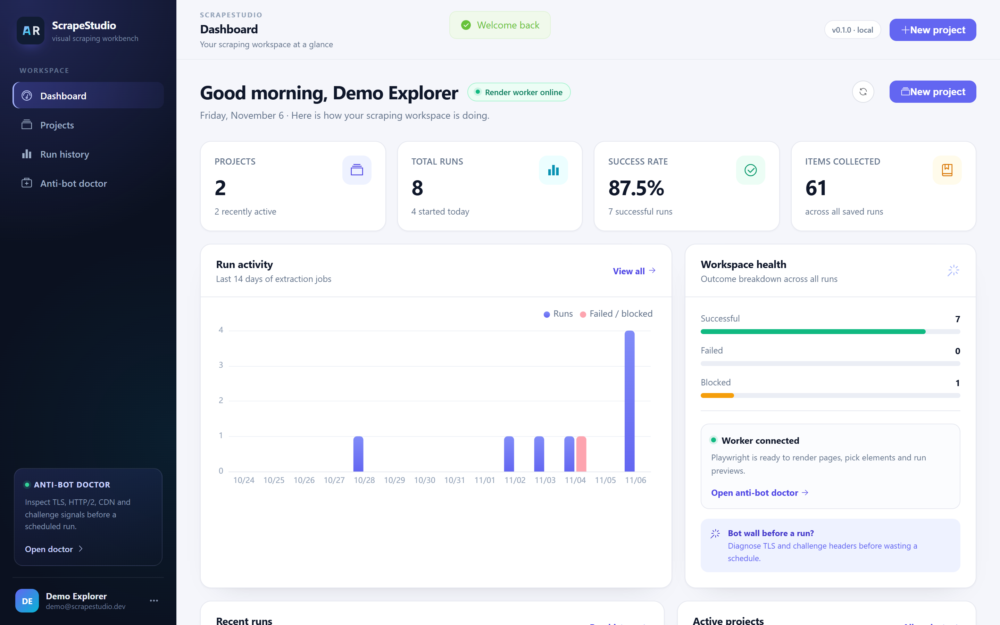
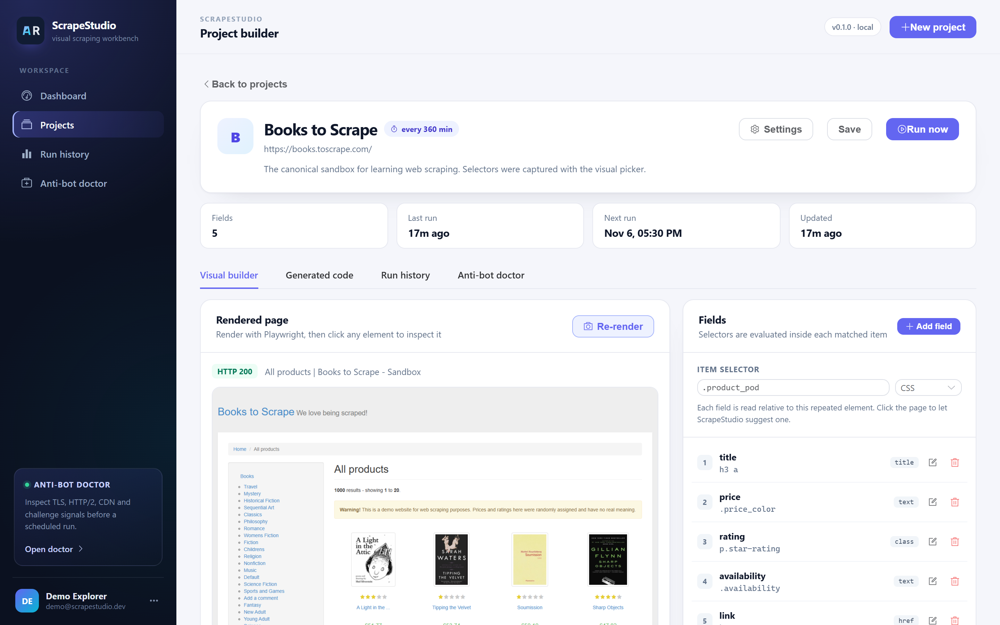
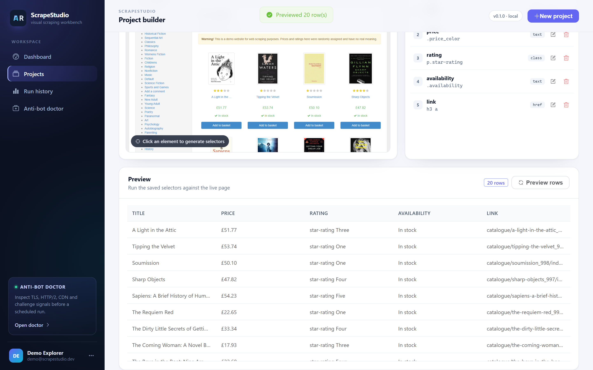
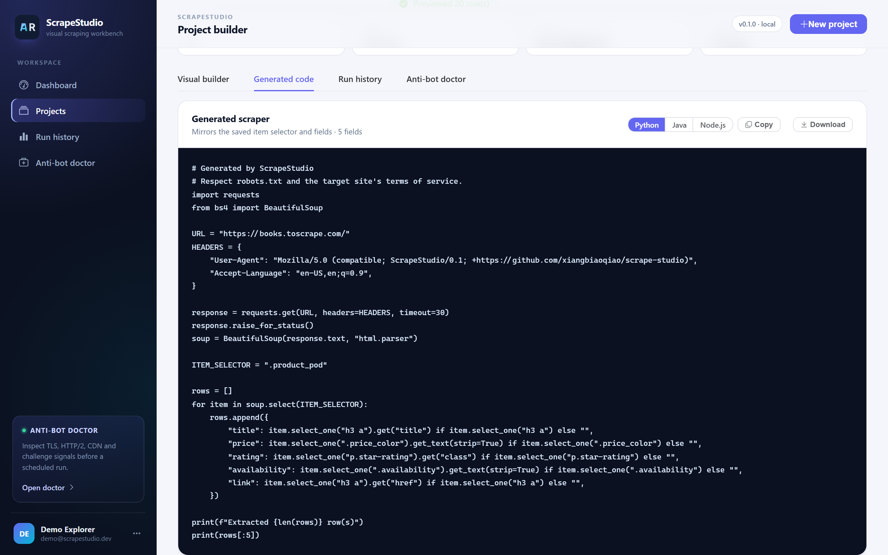
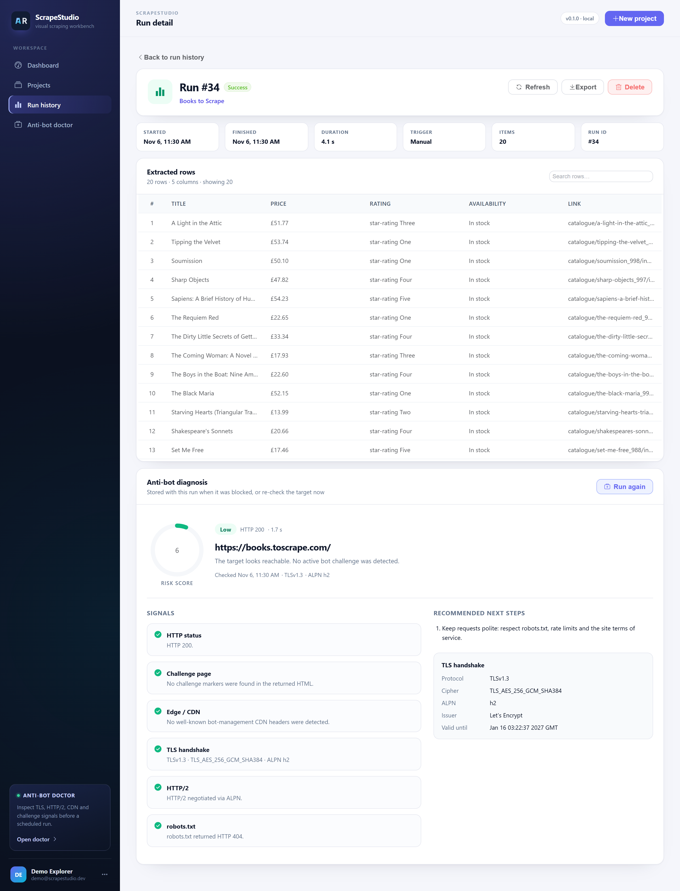
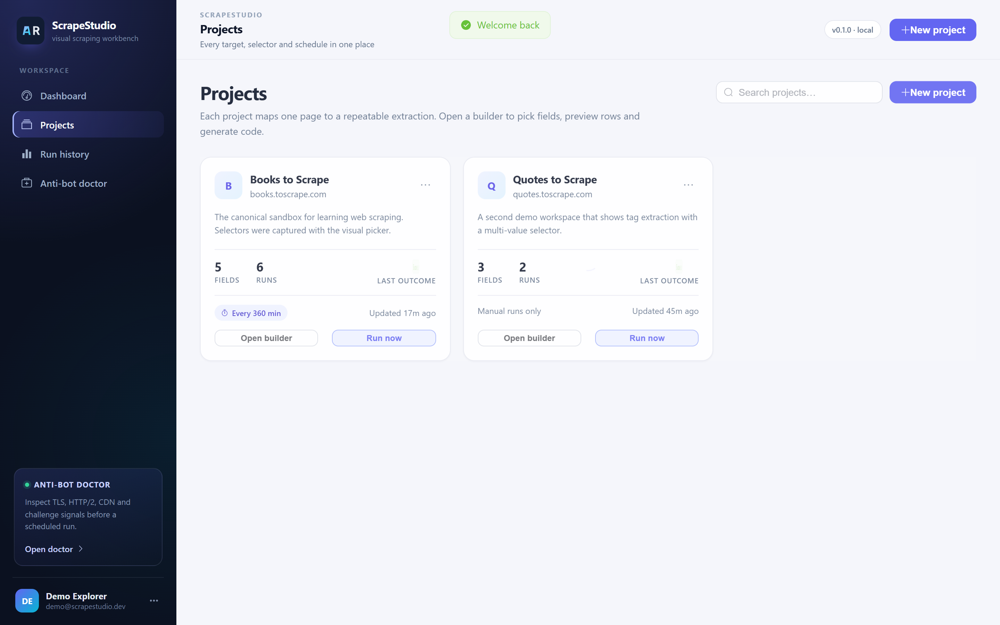
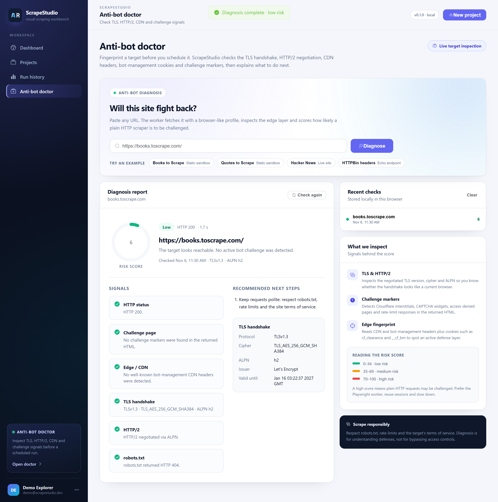
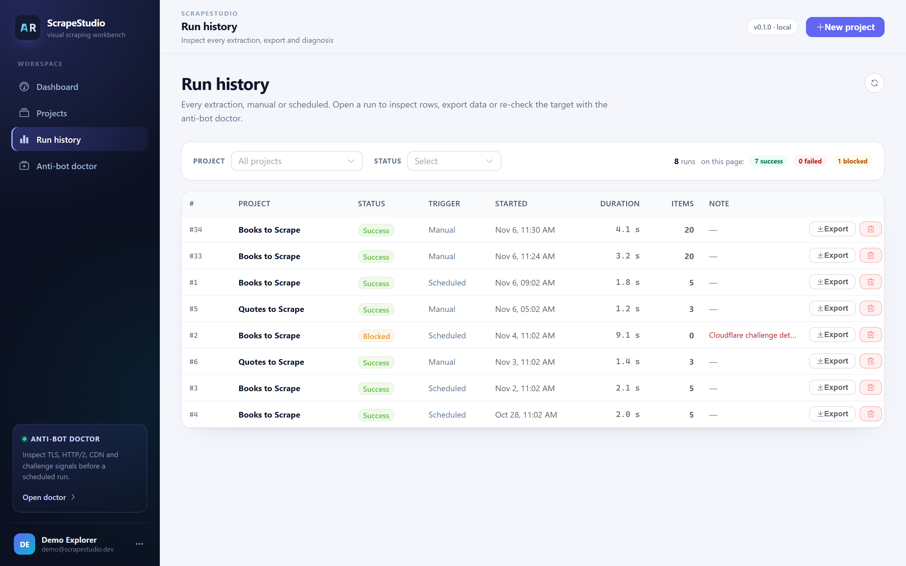
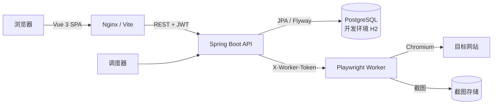

<div align="center">

# ScrapeStudio

**带内置反爬诊断的可视化网页采集工作台。**

在页面上点几下完成字段配置，实时预览真实数据，生成可直接运行的代码，定时执行任务，并在采集中断时告诉你网站到底在拦截什么。

[English](README.md) · [功能](#-功能) · [快速开始](#-快速开始) · [界面截图](#-界面截图) · [架构](#-架构)

[](https://github.com/xiangbiaoqiao/scrape-studio/actions/workflows/ci.yml)
[](https://adoptium.net/)
[](https://spring.io/projects/spring-boot)
[](https://vuejs.org/)
[](https://www.typescriptlang.org/)
[](https://playwright.dev/)
[](LICENSE)

<sub>如果这个项目帮你省了时间，点个 ⭐ 就是最好的支持。</sub>

</div>



## 为什么做 ScrapeStudio？

大多数采集工具只负责“把选择器跑一遍”。真正的麻烦往往在后面：页面改版、频率限制、挑战页、凌晨三点任务悄悄返回 0 条数据。

ScrapeStudio 想覆盖完整的工作流：

- **可视化搭建** —— 直接点击渲染后的页面截图，不用盲猜 CSS。
- **立即验证** —— 保存前就能预览真实数据行。
- **随时交付** —— 一键生成 Python、Java、Node.js 三种代码。
- **持续运行** —— 定时任务、运行历史、CSV/JSON 导出、失败原因一目了然。
- **诊断拦截** —— 反爬医生检查 TLS、HTTP/2、CDN 响应头、Cookie、robots.txt 和挑战页特征，并用直白的语言给出结论。

项目完全自托管，MIT 协议，技术栈刻意保持主流：Spring Boot、PostgreSQL、Vue 3、Playwright。

## ✨ 功能

| 模块 | 能力 |
| --- | --- |
| **可视化搭建** | 服务端截图 + 点击选择元素；候选选择器按匹配质量排序，支持 CSS 与 XPath。 |
| **字段引擎** | 文本、HTML、任意属性；单值/多值；独立选择器类型；字段有序、支持就地编辑。 |
| **实时预览** | 用已保存的选择器访问真实页面，返回最多 500 行结构化数据、拦截警告和页面信息。 |
| **代码生成** | Python（requests + BeautifulSoup，XPath 场景自动切换 Playwright）、Java（Jsoup）、Node.js（Playwright）；支持复制与下载。 |
| **运行与导出** | 异步执行、结果持久化、耗时与条数统计、CSV/JSON 导出、删除运行记录、单次运行诊断。 |
| **定时调度** | 每个项目独立间隔，30 秒调度循环，避免重复触发，展示下次执行时间。 |
| **反爬医生** | 根据 HTTP 状态、挑战页特征、CDN 指纹、TLS 版本/加密套件/ALPN、HTTP/2、反爬 Cookie、重定向链和 robots.txt 计算风险分与结论。 |
| **仪表盘** | 项目/运行总数、成功率、累计条数、14 天活动图、Worker 健康状态、最近运行。 |
| **多用户认证** | JWT 登录、按用户隔离项目、BCrypt 密码、内置演示工作区。 |
| **部署** | Docker Compose 一键拉起 PostgreSQL、Nginx、Spring Boot、Playwright Worker；自带 GitHub Actions CI。 |

## 🚀 快速开始

### 方式 A —— Docker Compose（推荐）

环境要求：Docker Engine 24+，Compose v2。

```bash
git clone https://github.com/xiangbiaoqiao/scrape-studio.git
cd scrape-studio
cp .env.example .env
# 修改 .env 中的 POSTGRES_PASSWORD、JWT_SECRET、WORKER_TOKEN
docker compose up --build
```

打开 **http://localhost:8088**，使用演示账号登录：

```text
demo@scrapestudio.dev
demo1234
```

常用配置：

- 修改 `WEB_PORT` 可以更换 Web 端口。
- 设置 `DEMO_ENABLED=false` 可获得干净的生产工作区。
- 部署到域名时，同步修改 `PUBLIC_BASE_URL` 和 `CORS_ORIGINS`。

> 首次构建需要下载 Playwright 镜像，可能耗时几分钟。Worker 为 Chromium 分配了 1 GB 共享内存。

### 方式 B —— 本地开发

环境要求：JDK 17、Maven 3.9+、Node.js 22+，以及 Chrome/Edge 或 Playwright 自带 Chromium。

**1. Worker —— Playwright 渲染服务**

```bash
cd worker
npm install
npx playwright install chromium   # 已安装 Chrome/Edge 可跳过
npm run dev
```

Worker 监听 `http://localhost:8787`，默认令牌为 `dev-worker-token`。

**2. 后端 —— Spring Boot API**

```bash
cd backend
mvn -DskipTests package
java -jar target/scrape-studio-api-0.1.0.jar
```

API 监听 `http://localhost:8080`。本地开发使用 H2 文件数据库 `backend/data/scrapestudio`，由 Flyway 自动迁移并写入演示数据。

- Swagger UI：`http://localhost:8080/swagger-ui.html`
- 健康检查：`http://localhost:8080/actuator/health`
- H2 控制台：`http://localhost:8080/h2-console`

**3. 前端 —— Vue 3 工作台**

```bash
cd frontend
npm install
npm run dev
```

打开 **http://localhost:5173**。Vite 会把 `/api` 代理到 `http://localhost:8080`。

> 端口冲突时，可用 `--server.port=8081` 启动后端，并在 `npm run dev` 前设置 `VITE_PROXY_TARGET=http://localhost:8081`。

## 📸 界面截图

| 可视化搭建 | 预览真实数据 |
| --- | --- |
|  |  |

| 生成代码 | 运行详情 |
| --- | --- |
|  |  |

| 项目管理 | 反爬医生 |
| --- | --- |
|  |  |

| 仪表盘 | 运行历史 |
| --- | --- |
|  |  |

## 🧠 可视化选择器是怎么工作的

1. Worker 用 Chromium 打开目标页面，等待 `domcontentloaded`，截取渲染后的视口截图。
2. 截图展示在搭建器中。点击时把渲染坐标换算成文档坐标。
3. 通过 `elementFromPoint` 找到元素，生成并评分多组候选选择器（稳定 class、`data-*` 属性、祖先路径、`nth-of-type`、XPath 兜底），返回最佳 item selector、字段候选、匹配数量和文本样例。
4. 你确认或修改字段名与属性后保存。item selector 会复用于所有字段。

后端只保存选择器和字段定义，不保存原始 HTML，因此项目体积小、可移植。

## 🩺 反爬医生检查什么

反爬医生会发起真实请求和真实 TLS 握手。它**不会**破解验证码或绕过防护，只负责告诉你面对的对手是什么。

| 信号 | 说明 |
| --- | --- |
| HTTP 状态 | 403/429 往往意味着封锁或限流，而不是页面结构损坏。 |
| 挑战页特征 | 识别常见的 "Just a moment"、Cloudflare、验证码和访问拒绝页面。 |
| 边缘/CDN 响应头 | 识别 Cloudflare、Akamai、Sucuri、CloudFront、Fastly。 |
| TLS 握手 | 展示协议、加密套件、ALPN、证书签发者和有效期。TLS 1.3 + HTTP/2 更接近现代浏览器。 |
| 反爬 Cookie | 标记 `cf_clearance`、`__cf_bm`、`ak_bmsc`、`datadome` 等。 |
| 重定向链 | 登录页或挑战页跳转可以解释“为什么没有数据”。 |
| robots.txt | 在安排生产任务前提示站点抓取规则。 |

每次诊断会返回 `low-risk`、`medium-risk`、`high-risk` 或 `unreachable` 结论、0–100 风险分、每个信号的证据，以及可执行的建议。

## 🏗 架构



**核心链路**

- **渲染/选择**：前端 → 后端 → Worker 会话 → 截图 + 候选选择器 → 搭建器。
- **预览/运行**：后端把 JPA 实体组装成字段规格 → Worker 在 Chromium 中抽取 → 后端持久化结果、状态、条数和耗时。
- **诊断**：后端转发给 Worker，Worker 执行 HTTP 请求、TLS 检查、robots.txt 读取和拦截检测。
- **代码生成**：纯后端转换，不依赖 Worker 或网络。

更完整的数据模型、安全边界、失败处理与取舍见 [docs/ARCHITECTURE.md](docs/ARCHITECTURE.md)。

## 🛠 技术栈

| 层次 | 技术 |
| --- | --- |
| 前端 | Vue 3、TypeScript、Vite、Pinia、Vue Router、Element Plus、ECharts |
| 后端 | Java 17、Spring Boot 3.3、Spring Security、Spring Data JPA、Flyway、JWT、springdoc OpenAPI |
| Worker | Node.js 22、TypeScript、Fastify、Playwright（Chromium） |
| 数据 | 本地开发 H2，生产 PostgreSQL 16 |
| 运维 | Docker Compose、Nginx、GitHub Actions |

所有技术都是成熟主流方案：没有私有运行时、没有冷门数据库、没有频繁换代的前端框架，招聘和交接成本都低。

## 📁 目录结构

```text
scrape-studio/
├── backend/                 Spring Boot API
│   ├── src/main/java/com/scrapestudio/
│   │   ├── auth/            JWT 认证与用户
│   │   ├── project/         项目、字段、选择器、代码生成
│   │   ├── run/             异步运行、调度、导出
│   │   ├── doctor/          反爬诊断代理
│   │   ├── dashboard/       聚合指标与活动趋势
│   │   ├── worker/          类型化 Worker 客户端与 DTO
│   │   ├── demo/            演示工作区初始化
│   │   └── config/          安全、CORS、OpenAPI、异步
│   └── src/main/resources/db/migration/
├── frontend/                Vue 3 + TypeScript SPA
│   └── src/{views,components,stores,api,layouts}
├── worker/                  Fastify + Playwright 渲染服务
│   └── src/{index,pick,extract,diagnose,block,browser}.ts
├── docs/                    架构、发布指南、简历素材
├── docker-compose.yml
└── .github/workflows/ci.yml
```

## 🔌 API 一览

除认证、健康检查和 OpenAPI 外，所有接口都需要 `Authorization: Bearer <token>`。

| 方法 | 路径 | 用途 |
| --- | --- | --- |
| `POST` | `/api/auth/register` | 注册账号 |
| `POST` | `/api/auth/login` | 获取 JWT |
| `GET` | `/api/projects` | 分页项目列表 |
| `POST` | `/api/projects` | 创建项目 |
| `GET` | `/api/projects/{id}` | 项目详情与字段 |
| `POST` | `/api/projects/{id}/render` | 创建截图会话 |
| `POST` | `/api/projects/{id}/pick` | 把点击解析为选择器 |
| `POST` | `/api/projects/{id}/preview` | 抽取预览数据 |
| `GET` | `/api/projects/{id}/code?language=python` | 生成代码（`python`、`java`、`node`） |
| `POST` | `/api/projects/{id}/runs` | 触发运行 |
| `GET` | `/api/runs` | 可筛选的运行历史 |
| `GET` | `/api/runs/{id}/export?format=csv` | 导出 `csv` 或 `json` |
| `POST` | `/api/doctor/diagnose` | 诊断目标 URL |
| `GET` | `/api/dashboard/summary` | 仪表盘聚合数据 |

交互式文档位于 `/swagger-ui.html`。

## 📚 项目文档

- [架构说明](docs/ARCHITECTURE.md) —— 组件、数据模型、核心链路、安全边界、失败处理与取舍。
- [发布指南](docs/LAUNCH.md) —— 发布前检查、GitHub 配置、Docker 验证与发布文案。
- [简历与面试素材](docs/RESUME.md) —— 可核实的项目描述与面试表达。

## ⚖️ 合规与边界

ScrapeStudio 面向合法的数据采集：公开数据、自有站点、研究，以及目标条款允许的工作流。

- 反爬医生会展示 robots.txt 与挑战信号，帮助你做判断。
- 它不破解验证码、不轮换代理、不绕过登录认证。
- 定时任务请保持克制，尊重限流与服务器负载。
- 生成的代码会提醒你检查 robots.txt 和站点条款。

使用方式由你负责。

## 🗺 路线图

- [ ] 分页与详情页遍历
- [ ] 项目 JSON 导入/导出
- [ ] 失败任务 Webhook / 邮件通知
- [ ] 代理配置与项目级请求头
- [ ] 两次运行之间的选择器漂移对比
- [ ] 团队工作区与角色权限

## 🤝 参与贡献

欢迎提交 Issue 和 Pull Request。较大的改动请先开 Issue 讨论设计。提交前请运行与 CI 相同的检查：

```bash
cd backend && mvn test
cd frontend && npm run typecheck && npm run build
cd worker && npm run typecheck && npm run build
```

## 📄 许可证

[MIT](LICENSE) © 2026 xiangbiaoqiao

---

<div align="center">

**如果 ScrapeStudio 帮你省下了调选择器的时间，欢迎点一个 Star。⭐**

</div>
