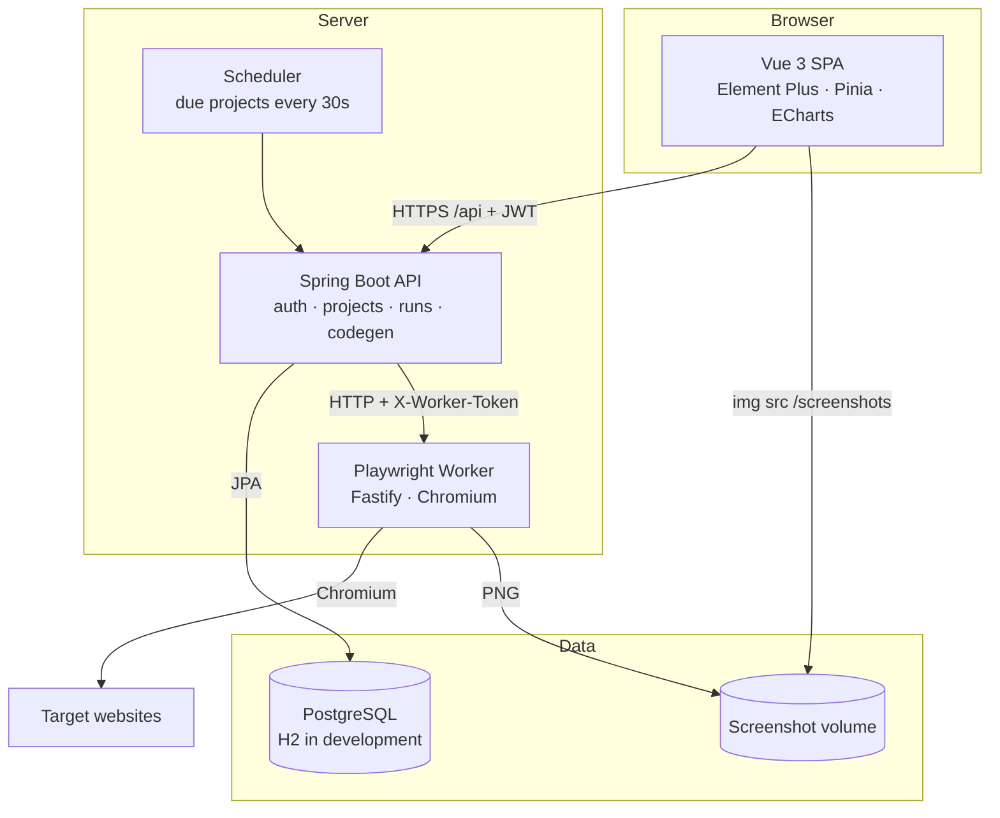
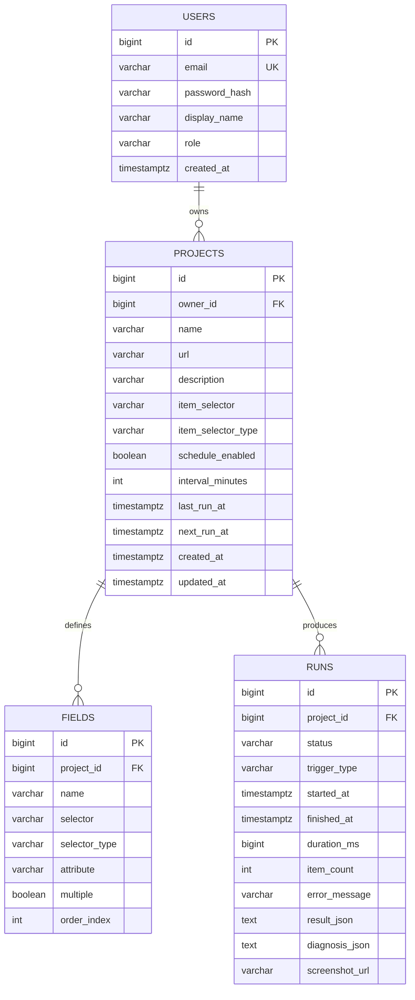
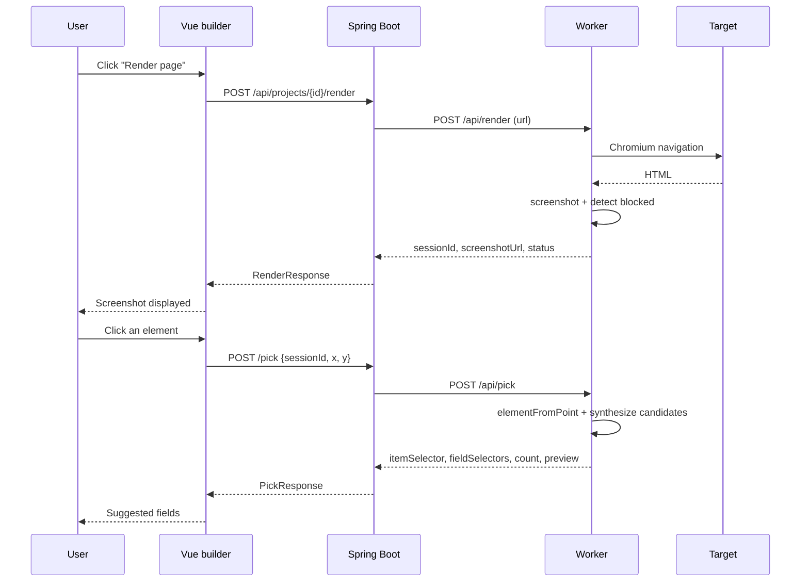
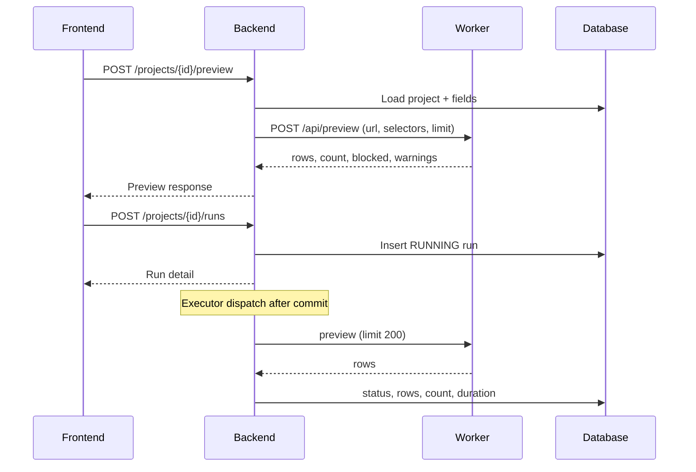
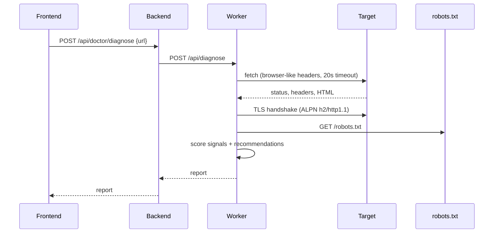

# Architecture

This document explains how ScrapeStudio is put together, why the boundaries sit where they do, and what to watch out for when running it in production.

- [1. Design goals](#1-design-goals)
- [2. System context](#2-system-context)
- [3. Components](#3-components)
- [4. Data model](#4-data-model)
- [5. Key flows](#5-key-flows)
- [6. Security model](#6-security-model)
- [7. Failure handling](#7-failure-handling)
- [8. Code generation](#8-code-generation)
- [9. Deployment topology](#9-deployment-topology)
- [10. Trade-offs and extension points](#10-trade-offs-and-extension-points)

## 1. Design goals

ScrapeStudio is a self-hosted workbench, not a scraping SaaS. The architecture optimizes for:

1. **A small, understandable stack.** Spring Boot, PostgreSQL, Vue 3, and Playwright. No message broker, no Kubernetes operator, no custom DSL.
2. **Fast feedback.** A visual pick and preview should feel like an editor, not a batch job.
3. **Operational honesty.** Every run records status, duration, item count, error text, and optional diagnosis. Silent zero-row runs are treated as data, not success theater.
4. **Clean upgrade paths.** Browser automation is isolated in a separate worker so it can be scaled, containerized, or replaced without touching the API.
5. **Safe-by-default local development.** H2 and in-memory sessions mean `git clone && run` works without infrastructure.

Non-goals: CAPTCHA solving, proxy rotation, distributed crawling, and multi-tenant isolation at the network level. See [Security model](#6-security-model).

## 2. System context



The browser talks only to the API. The worker is an internal service: it is not published by the production Compose file and is reachable only from the backend network and the Nginx screenshot proxy.

## 3. Components

### 3.1 Frontend (`frontend/`)

| Concern | Implementation |
| --- | --- |
| Framework | Vue 3 `<script setup>` + TypeScript |
| Routing | Vue Router, lazy-loaded views, auth guard |
| State | Pinia `auth` store; view-local state elsewhere |
| HTTP | Typed `fetch` wrapper with JWT injection, 401 handling, and `ApiError` |
| UI | Element Plus, custom CSS variables, ECharts activity chart |
| Pages | Dashboard, Projects, Project detail/builder, Runs, Run detail, Anti-bot doctor, Login |

The builder is the most stateful screen. It keeps the current project, field draft dialog, render session, pick result, preview rows, generated code, and run state in one component, with API calls delegated to `src/api/client.ts`.

### 3.2 Backend (`backend/`)

| Package | Responsibility |
| --- | --- |
| `auth` | Register/login, BCrypt, JWT issue/parse, request filter |
| `user` | User entity and repository |
| `project` | Project/field CRUD, URL normalization, picker proxying, code generation |
| `run` | Run creation, async execution, scheduling, filtering, exports |
| `doctor` | Validation and proxy to the worker diagnosis endpoint |
| `dashboard` | Aggregates, 14-day activity, worker health |
| `worker` | `RestClient` wrapper, timeouts, typed DTOs |
| `demo` | Idempotent demo workspace seeding |
| `config` | Security, CORS, OpenAPI, async executor, properties |
| `common` | `ApiException`, global error mapping, pagination wrapper |

The backend owns all persistent state. The worker is stateless between requests except for short-lived render sessions.

### 3.3 Worker (`worker/`)

Fastify service with five functional endpoints:

| Endpoint | Behavior |
| --- | --- |
| `GET /api/health` | Reports launch mode, active sessions, uptime. Public within the service. |
| `POST /api/render` | Opens a page, screenshots the viewport, stores a session in memory, returns `sessionId` + screenshot URL + block flags. |
| `POST /api/pick` | Resolves `(x, y)` in a session to selector candidates and an element preview. |
| `POST /api/preview` | Opens a fresh context, applies the item selector and field specs, returns up to 500 rows. |
| `POST /api/diagnose` | HTTP request + TLS inspection + robots.txt + challenge detection; returns a risk report. |

Implementation files:

- `browser.ts` — lazy Chromium launch with a fallback chain: configured channel → bundled Chromium → system Chrome → system Edge.
- `pick.ts` — selector synthesis and scoring.
- `extract.ts` — CSS/XPath extraction, text/HTML/attribute values, multi-value handling.
- `block.ts` — challenge and rate-limit detection.
- `diagnose.ts` — TLS, CDN, robots, scoring, recommendations.
- `index.ts` — routes, session TTL cleanup, token guard, static screenshots.

All worker endpoints except `/api/health` and `/screenshots/*` require `X-Worker-Token`.

## 4. Data model



**Schema choices**

- Flyway `V1__init.sql` is the single source of truth; Hibernate runs with `ddl-auto: validate`, so schema drift fails fast.
- `result_json` stores extracted rows as a JSON array. It keeps exports and the dynamic table trivial and avoids a wide, project-specific table.
- `diagnosis_json` snapshots the report at the time of diagnosis so historical runs remain explainable even if the target changes.
- Foreign keys cascade on delete: removing a user removes projects, fields, and runs.
- Project ownership is enforced in repository queries (`findByIdAndProjectOwnerId`, `findByOwnerId...`), not only in controllers.

## 5. Key flows

### 5.1 Render and pick



The screenshot is a viewport capture; click coordinates therefore map directly to page coordinates. Render sessions expire after 10 minutes of inactivity and are closed by a 60-second cleanup loop.

### 5.2 Preview and run



Important details:

- Runs are dispatched only **after the transaction commits**, so the executor can never race an uncommitted run row.
- The worker call happens outside any database transaction. A slow page cannot hold a connection or lock.
- Preview allows 1–500 rows; persisted runs request 200. This keeps the JSON payload and UI responsive.
- A blocked page still persists rows (often empty) plus `BLOCKED` status and the block reason.
- Failures are caught per run, stored as `FAILED`, and truncated to the column limit rather than crashing the executor.

### 5.3 Scheduling

`RunScheduler` runs every 30 seconds and selects projects where `schedule_enabled = true` and `next_run_at <= now`. Before creating a run it checks whether the latest run is still `RUNNING`; if so, it pushes `next_run_at` forward instead of stacking executions. `createRun` advances the next run immediately, so a slow run cannot be scheduled twice.

This is intentionally a single-node scheduler. Running multiple backend replicas would require a database lock or an external scheduler; see [Trade-offs](#10-trade-offs-and-extension-points).

### 5.4 Anti-bot diagnosis



The diagnosis request uses Node's `fetch` and `tls`, not Chromium. That is deliberate: it exposes the network/TLS/CDN layer that a plain HTTP client sees, independently of browser JavaScript execution. The render/preview path uses Chromium.

Diagnosis is also persisted per run when triggered from a run detail page, enabling later comparison.

## 6. Security model

### Authentication and authorization

- Passwords are hashed with BCrypt.
- Login returns a signed JWT (HS256, configurable secret and expiration).
- `JwtAuthFilter` validates the token on every request and loads the user.
- Spring Security is stateless; CSRF is disabled because the API is token-based and does not use cookies for auth.
- Every project/run query includes the authenticated owner ID. A missing or foreign ID returns `404`, not `403`, to avoid resource enumeration.

### Service-to-service

- The backend sends `X-Worker-Token` on every worker call.
- The worker rejects all non-health requests without a matching token.
- The token is separate from the JWT secret and should be rotated independently.
- In Compose, the worker has no published port; only Nginx proxies `/screenshots/`.

### URL fetching and SSRF

ScrapeStudio intentionally fetches arbitrary user-supplied URLs. In a single-user/self-hosted deployment this is the product. In a multi-tenant deployment, it is an SSRF surface: users could target `localhost`, private ranges, or cloud metadata endpoints.

Recommended controls if you expose ScrapeStudio to untrusted users:

1. Run the worker in a network namespace with egress allowlists.
2. Block link-local and private CIDRs at the container/network layer.
3. Put the API behind SSO and restrict account creation.
4. Serve screenshots through authenticated, signed URLs instead of UUID paths.

### Screenshot exposure

Screenshots are written to a volume with UUID filenames and served without a token. This is convenient for `` tags and demo use. The UUID is unguessable, but it is **not** an authorization boundary. Treat screenshot URLs as capability URLs and avoid sharing them publicly.

### Secrets

`.env` is gitignored. `application.yml` contains development defaults only. Production Compose requires `POSTGRES_PASSWORD`, `JWT_SECRET`, and `WORKER_TOKEN` to be set in `.env`; do not ship the defaults.

## 7. Failure handling

| Failure | Behavior |
| --- | --- |
| Worker offline | Backend returns `502` with a readable message; dashboard reports `workerOnline: false`; runs fail with the worker error. |
| Target unreachable / TLS failure | Worker returns `502` for render/preview; runs are marked `FAILED`; doctor returns `unreachable` with score 100. |
| Challenge page / 403 / 429 | `detectBlocked` returns a reason; preview exposes `blocked`; runs are marked `BLOCKED`; UI shows a warning. |
| Render session expired | Pick returns `404`; the user re-renders. |
| Selector matches nothing | Preview returns zero rows; this is a valid result, not an exception. |
| Run crashes | `RunRunner` catches, stores `FAILED` and a truncated error, and always records duration. |
| Scheduler overlap | Latest `RUNNING` run defers the project to the next interval. |
| Backend restart | Persisted runs and projects survive; in-memory render sessions are lost by design. |
| Malformed stored JSON | Row parsing returns an empty list instead of breaking the run detail page. |

The worker also has request-level timeouts: 45 seconds for navigation, 20 seconds for diagnosis fetch, 7 seconds for TLS, 6 seconds for robots.txt, and a 90-second backend read timeout. Tune these via `NAVIGATION_TIMEOUT_MS` and backend properties for slow targets.

## 8. Code generation

`CodeGenerator` is a pure function over `ProjectDetail`. It never calls the worker.

| Target | Runtime | Selector support | Notes |
| --- | --- | --- | --- |
| Python | `requests` + BeautifulSoup | CSS | Default for CSS projects; no browser required. |
| Python | Playwright sync API | CSS + XPath | Selected automatically when the item or any field uses XPath. |
| Java | Jsoup | CSS | Single-file `ScrapeResult` with `main`. XPath projects should use Python or Node export. |
| Node.js | Playwright | CSS + XPath | Top-level `await`, ESM import. |

Supported field attributes:

- `text` (default) → inner text, trimmed.
- `html` → inner/outer HTML depending on runtime.
- any other value → DOM attribute via `getAttribute` / `.get` / `.attr`.

Multi-value fields return lists (Python/Node) or a `" | "`-joined string (Java, to keep the example dependency-free and simple).

The generator escapes quotes and backslashes, handles empty field lists, and prefixes XPath selectors with `xpath=` for Playwright. It is template-based rather than AST-based: generated code is meant to be a readable starting point, not a guarantee for every edge case.

## 9. Deployment topology

```text
                    :8088 (configurable)
                           │
                    ┌──────▼──────┐
                    │    Nginx    │  static SPA + /api + /screenshots
                    └──┬───────┬──┘
                       │       │
             /api      │       │ /screenshots
                       ▼       ▼
                ┌──────────┐  ┌────────────┐
                │ Backend  │  │  Worker    │
                │ :8080    │  │  :8787     │
                └────┬─────┘  └─────┬──────┘
                     │              │
                ┌────▼─────┐   ┌────▼─────────┐
                │Postgres  │   │ Chromium     │
                │ volume   │   │ screenshots  │
                └──────────┘   └──────────────┘
```

- `postgres` has a `pg_isready` healthcheck; the backend waits for it.
- The backend healthcheck hits `/actuator/health`; the web container waits for it.
- The worker runs as `pwuser` from the official Playwright image and uses `shm_size: 1gb` for Chromium.
- Volumes persist PostgreSQL data and worker screenshots across restarts.
- Nginx serves the SPA with history fallback, caches hashed assets for a year, and proxies API/screenshot traffic.

Production checklist:

- Set strong `POSTGRES_PASSWORD`, `JWT_SECRET` (32+ chars), and `WORKER_TOKEN`.
- Set `PUBLIC_BASE_URL` and `CORS_ORIGINS` to the real HTTPS origin.
- Set `DEMO_ENABLED=false` unless you want the demo account.
- Terminate TLS at a reverse proxy or load balancer in front of Nginx.
- Restrict worker egress if users are untrusted.
- Back up the PostgreSQL volume; screenshots are reproducible but may be retained for audits.

## 10. Trade-offs and extension points

### Deliberate trade-offs

| Decision | Benefit | Cost |
| --- | --- | --- |
| Screenshot-based picking | Works with cross-origin pages and strict CSP; no extension required | Only the current viewport is pickable; no hover states or iframes |
| In-memory worker sessions | Simple, fast, no session store | Not horizontally scalable; sessions die on restart |
| JSON result column | Flexible schema, trivial export, no migrations per field | Hard to query individual fields in SQL; capped rows per run |
| Single-node scheduler | No extra infrastructure | Multiple API replicas need a distributed lock |
| Template-based codegen | Readable output, zero runtime deps for generation | Not a full compiler; complex edge cases may need manual edits |
| H2 in development | Zero-setup onboarding | Some PostgreSQL-specific behavior is only exercised in prod |

### Where to extend

- **New language export**: add a branch in `CodeGenerator.generate` and a matching test in `CodeGeneratorTest`.
- **New diagnosis signal**: append a `Signal` in `worker/src/diagnose.ts` and adjust the risk scoring block.
- **New field type**: extend `Field` + the extraction switch in `worker/src/extract.ts` and the generated-code emitters.
- **Distributed scheduling**: replace `RunScheduler` with a database advisory lock or Quartz.
- **Pagination**: add a `pagination` JSON block to the project and a loop in the worker and codegen.
- **Object storage**: swap the worker's local screenshot directory for S3-compatible storage and change the URL builder.

The current seams are intentionally small: `WorkerClient` isolates the worker contract, `ProjectRunSpec`-style DTOs keep JPA out of transport, and the frontend's `api/client.ts` is the only place that knows endpoint shapes.
